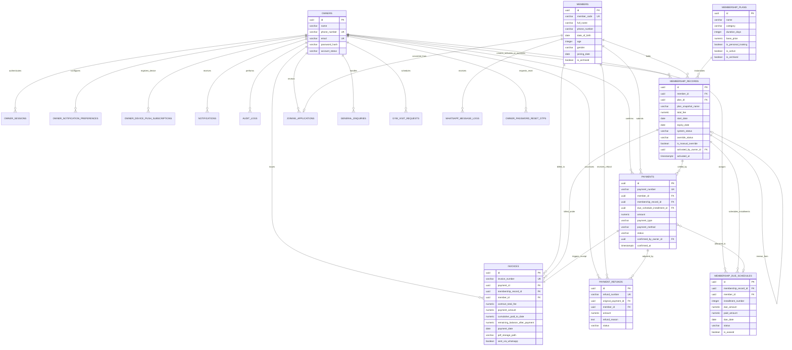

# Regal Fitness — Production PostgreSQL Database Schema Specification
## Phase 0.2 (Approved Revision 2) | Developer 2 (Backend & Core Management Architecture)

---

## 1. Overview

This document specifies the revised, production-grade PostgreSQL relational database schema for **Regal Fitness**, a commercial gym management platform.

The system is engineered for dual-stakeholder gym ownership, managing all core operational workflows: member lifecycle tracking, plan administration, strict double-entry-style payment verification, immutable payment receipts, multi-device notification distribution, append-only audit logging, and customer inquiry intake from the public website.

### Architecture Scope
- **Backend Role (Developer 2):** Complete schema governance, financial transaction integrity, owner administration, member and billing records, audit compliance, and system integrations.
- **Frontend Role (Developer 1):** Consumes public intake surfaces (joining applications, general inquiries, gym visit bookings, public gallery viewing, and published membership plans).
- **Primary Design Tenet:** Financial correctness, explicit operational authority, and historical immutability. No confirmed financial transaction, issued receipt, or historical membership contract is ever modified in-place or silently overwritten.

---

## 2. Database Technology and Conventions

| Component | Standard / Selection | Architectural Justification |
|---|---|---|
| **RDBMS** | PostgreSQL 16+ | Native JSONB support, transactional DDL, partial indexes, check constraints, high concurrency with MVCC. |
| **ORM Compatibility** | SQLAlchemy 2.0 | Full type-annotated DeclarativeBase support, relationship mapping, and async session scalability. |
| **Migration Tool** | Alembic | Sequential, deterministic, autogenerated schema migration revisions. |
| **Validation Layer** | Pydantic v2 / Pydantic Settings | Strict schema boundary validation across all inbound requests and outbound API payloads. |
| **Primary Keys** | UUIDv4 (`UUID`) | Non-enumerable, collision-safe in distributed/multi-threaded contexts, protects business volume from client scraping. |
| **Member Codes** | Sequential String (`RF001`, `RF002`...) | Formatted by dedicated PostgreSQL sequence (`member_code_seq`). Starts with 3-digit zero padding and naturally expands beyond 999 (`RF1000`, `RF1001`...). |
| **Invoice Numbers** | Continuous Sequence (`INV-00001`, `INV-00002`...) | Formatted by a dedicated, non-resetting PostgreSQL sequence (`invoice_number_seq`). Never resets annually or financially. Concurrency-safe and strictly increasing, though gaps may occur if an uncommitted transaction aborts. |
| **Payment Numbers** | Continuous Sequence (`PAY-00001`, `PAY-00002`...) | Formatted by continuous sequence (`payment_number_seq`). Unique identifier for each transaction attempt. |
| **Monetary Values** | `NUMERIC(10, 2)` / `DECIMAL(10, 2)` | Exact fixed-point numeric math. Floats are strictly prohibited to prevent IEEE 754 rounding drift. |
| **Calendar Dates** | `DATE` | Timezone-agnostic dates for member birthdays, plan duration boundaries, and membership terms. |
| **Timestamps** | `TIMESTAMPTZ` (UTC) | Absolute timezone-aware timestamps stored in UTC (`timezone('utc', now())`). |
| **Text Fields** | `VARCHAR(N)` / `TEXT` | Bounded `VARCHAR` for structured attributes (codes, phone numbers); `TEXT` for open comments, addresses, and JSON payloads. |
| **Soft Deletes** | `is_archived` / `archived_at` | Zero permanent hard deletion of members, plans, payments, or invoices through application logic. |

---

## 3. Naming Conventions

To guarantee consistency across Alembic migrations, PostgreSQL catalogs, and SQLAlchemy models:

1. **Tables:** Snake case, plural nouns (e.g., `members`, `membership_records`, `payments`, `audit_logs`).
2. **Columns:** Snake case, singular nouns or noun phrases (e.g., `phone_number`, `total_fee`, `is_active`).
3. **Primary Keys:** Always named `id` of type `UUID`.
4. **Foreign Keys:** Singular target entity name followed by `_id` (e.g., `member_id`, `plan_id`, `handling_owner_id`).
5. **Boolean Flags:** Prefixed with `is_`, `has_`, or `wants_` (e.g., `is_archived`, `is_cover_image`, `wants_visit_first`).
6. **Timestamps:** Suffix `_at` for UTC timestamps (`created_at`, `updated_at`, `confirmed_at`, `activated_at`).
7. **Dates:** Suffix `_date` for calendar-only dates (`start_date`, `expiry_date`, `joining_date`).
8. **Indexes:**
   - Primary Key: `pk_<table_name>`
   - Foreign Key: `idx_<table_name>_<column_name>`
   - Unique Constraint: `uq_<table_name>_<column_name>`
   - Partial Unique Index: `idx_uq_<table_name>_<purpose>`
   - Composite Index: `idx_<table_name>_<col1>_<col2>`
   - Check Constraint: `ck_<table_name>_<condition_summary>`

---

## 4. Complete Table Inventory (21 Tables)

Every table represents a distinct, necessary operational domain. The inventory has been fully audited:

| # | Table Name | Module | Purpose |
|---|---|---|---|
| 1 | `owners` | Owner Management | Administrator accounts for the two co-owners with identical permissions. |
| 2 | `owner_notification_preferences` | Owner Management | Alert topic and channel preferences (in-app, WhatsApp, push) per owner. |
| 3 | `owner_device_push_subscriptions` | Owner Management | Multiple push device tokens/endpoints per owner (mobile, tablet, desktop). |
| 4 | `owner_password_reset_otps` | Owner Management | Server-secret-keyed HMAC hashed, rate-limited, single-use recovery OTP tokens. |
| 5 | `owner_sessions` | Owner Management | Long-lived refresh token hashes and active session metadata. |
| 6 | `members` | Member Management | Core gym member directory with lifecycle tracking and searchability. |
| 7 | `membership_plans` | Plan Catalog | Base plan catalog offering duration, pricing, and category configurations. |
| 8 | `membership_records` | Membership Lifecycle | Historical contracts holding snapshots of plans, terms, activation audits, and dual statuses. |
| 9 | `payments` | Financial Ledger | Immutable record of cash, UPI, and manual owner-verified transactions. |
| 10 | `payment_refunds` | Financial Ledger | Explicit adjustment and refund records for financial corrections. |
| 11 | `membership_due_schedules` | Receivables & Dues | Multi-installment due dates, installment tracking, and debt waivers. |
| 12 | `invoices` | Billing & Receipts | Permanent, immutable receipts generated for each confirmed payment. |
| 13 | `joining_applications` | Public Website (Dev 1) | Prospect applications submitted via the public landing page. |
| 14 | `general_enquiries` | Public Website (Dev 1) | Inquiries submitted through the public website contact forms. |
| 15 | `gym_visit_requests` | Public Website (Dev 1) | Scheduled physical gym tour requests and owner negotiation logs. |
| 16 | `notifications` | Internal Alerts | In-app alerts for critical business, member, and payment triggers. |
| 17 | `audit_logs` | Security & Compliance | Append-only ledger recording actor, action, previous/new states, and IPs. |
| 18 | `gallery_images` | Content Management | Metadata and display ordering for public homepage gym photos. |
| 19 | `system_settings` | Platform Configuration | Global operational settings, gym details, and encrypted secrets. |
| 20 | `whatsapp_message_logs` | Communication | Delivery logs, external message IDs, and failure tracking for WhatsApp. |
| 21 | `system_sequences` | Concurrency Controls | Sequence metadata registry for concurrency-safe business identifiers. |

---

## 5. Detailed Table Definitions

### 5.1 Module A: Owner Management

#### Table: `owners`
Stores the login accounts of the two co-owners. Both owners possess identical root-level system permissions.

| Column | Data Type | Constraints | Description |
|---|---|---|---|
| `id` | `UUID` | `PRIMARY KEY DEFAULT gen_random_uuid()` | Internal unique owner identifier. |
| `name` | `VARCHAR(100)` | `NOT NULL` | Full display name of the gym owner. |
| `phone_number` | `VARCHAR(20)` | `NOT NULL, UNIQUE` | Owner mobile phone number (E.164 format). |
| `email` | `VARCHAR(255)` | `NOT NULL, UNIQUE` | Administrative email for system notifications and alerts. |
| `password_hash` | `VARCHAR(255)` | `NOT NULL` | Argon2id or Bcrypt cryptographic password hash. |
| `account_status` | `VARCHAR(20)` | `NOT NULL DEFAULT 'active'` | State: `'active'`, `'inactive'`, `'suspended'`. |
| `last_login_at` | `TIMESTAMPTZ` | `NULLABLE` | Timestamp of the most recent successful authentication. |
| `created_at` | `TIMESTAMPTZ` | `NOT NULL DEFAULT timezone('utc', now())` | Record insertion timestamp. |
| `updated_at` | `TIMESTAMPTZ` | `NOT NULL DEFAULT timezone('utc', now())` | Record modification timestamp. |

#### Table: `owner_notification_preferences`
Controls which operational alerts are dispatched to each individual owner across available channels.

| Column | Data Type | Constraints | Description |
|---|---|---|---|
| `id` | `UUID` | `PRIMARY KEY DEFAULT gen_random_uuid()` | Preference entry ID. |
| `owner_id` | `UUID` | `NOT NULL, UNIQUE, REFERENCES owners(id) ON DELETE CASCADE` | 1:1 link to owner record. |
| `notify_new_application` | `BOOLEAN` | `NOT NULL DEFAULT TRUE` | Alert when a public joining application is submitted. |
| `notify_new_enquiry` | `BOOLEAN` | `NOT NULL DEFAULT TRUE` | Alert on new general contact inquiry. |
| `notify_new_visit` | `BOOLEAN` | `NOT NULL DEFAULT TRUE` | Alert when a gym visit is requested. |
| `notify_payment_confirmation` | `BOOLEAN` | `NOT NULL DEFAULT TRUE` | Alert when a payment requires verification or is logged. |
| `notify_upcoming_expiry` | `BOOLEAN` | `NOT NULL DEFAULT TRUE` | Alert on memberships expiring within 7 days. |
| `notify_overdue_dues` | `BOOLEAN` | `NOT NULL DEFAULT TRUE` | Alert on memberships exceeding assigned due dates. |
| `notify_daily_report_9am` | `BOOLEAN` | `NOT NULL DEFAULT TRUE` | Delivery of the consolidated 9:00 AM operational summary. |
| `channel_in_app` | `BOOLEAN` | `NOT NULL DEFAULT TRUE` | Render alerts inside the owner dashboard. |
| `channel_whatsapp` | `BOOLEAN` | `NOT NULL DEFAULT TRUE` | Forward notifications to the owner's WhatsApp number. |
| `channel_push` | `BOOLEAN` | `NOT NULL DEFAULT TRUE` | Dispatch web/mobile push notifications to active devices. |
| `updated_at` | `TIMESTAMPTZ` | `NOT NULL DEFAULT timezone('utc', now())` | Last configuration update. |

#### Table: `owner_device_push_subscriptions`
Enables multiple push notification subscriptions and devices (smartphones, tablets, laptops) per owner.

| Column | Data Type | Constraints | Description |
|---|---|---|---|
| `id` | `UUID` | `PRIMARY KEY DEFAULT gen_random_uuid()` | Device subscription ID. |
| `owner_id` | `UUID` | `NOT NULL, REFERENCES owners(id) ON DELETE CASCADE` | Associated co-owner. |
| `endpoint` | `TEXT` | `NOT NULL, UNIQUE` | Web Push endpoint URL or FCM device registration token. |
| `p256dh_key` | `TEXT` | `NULLABLE` | Web Push P-256 public encryption key. |
| `auth_key` | `TEXT` | `NULLABLE` | Web Push authentication secret. |
| `device_name` | `VARCHAR(100)` | `NULLABLE` | Human-readable label (e.g., "Owner iPhone 15", "Office PC"). |
| `user_agent` | `VARCHAR(255)` | `NULLABLE` | Browser and OS signature. |
| `is_active` | `BOOLEAN` | `NOT NULL DEFAULT TRUE` | Active delivery switch. Set to `FALSE` if endpoint becomes invalid (HTTP 410 Gone). |
| `last_used_at` | `TIMESTAMPTZ` | `NOT NULL DEFAULT timezone('utc', now())` | Timestamp of last successful push dispatch. |
| `created_at` | `TIMESTAMPTZ` | `NOT NULL DEFAULT timezone('utc', now())` | Subscription creation timestamp. |

#### Table: `owner_password_reset_otps`
Stores single-use, HMAC-hashed tokens for owner password resets. Plaintext OTPs are never stored.

| Column | Data Type | Constraints | Description |
|---|---|---|---|
| `id` | `UUID` | `PRIMARY KEY DEFAULT gen_random_uuid()` | Reset token ID. |
| `owner_id` | `UUID` | `NOT NULL, REFERENCES owners(id) ON DELETE CASCADE` | Target owner requesting reset. |
| `otp_hmac` | `VARCHAR(255)` | `NOT NULL` | HMAC-SHA256 hash of the generated 6-digit numeric OTP using a dedicated server secret key. |
| `attempts_count` | `INTEGER` | `NOT NULL DEFAULT 0` | Invalid verification attempts (permanently locks token at $\ge 3$). |
| `is_used` | `BOOLEAN` | `NOT NULL DEFAULT FALSE` | Flag flipped to `TRUE` immediately upon successful verification. |
| `cooldown_until` | `TIMESTAMPTZ` | `NOT NULL` | Rate limiting cooldown (blocks re-issuance for 60 seconds). |
| `expires_at` | `TIMESTAMPTZ` | `NOT NULL` | Strict expiration barrier (10 minutes from issuance). |
| `created_at` | `TIMESTAMPTZ` | `NOT NULL DEFAULT timezone('utc', now())` | Issuance timestamp. |

#### Table: `owner_sessions`
Tracks active owner authentication sessions and cryptographically hashed refresh tokens.

| Column | Data Type | Constraints | Description |
|---|---|---|---|
| `id` | `UUID` | `PRIMARY KEY DEFAULT gen_random_uuid()` | Session entry identifier. |
| `owner_id` | `UUID` | `NOT NULL, REFERENCES owners(id) ON DELETE CASCADE` | Associated owner. |
| `refresh_token_hash` | `VARCHAR(255)` | `NOT NULL, UNIQUE` | SHA-256 hash of the long-lived refresh JWT (never plaintext). |
| `device_info` | `VARCHAR(255)` | `NULLABLE` | Device/browser descriptor for session management. |
| `ip_address` | `VARCHAR(45)` | `NULLABLE` | Client IPv4 or IPv6 address. |
| `is_revoked` | `BOOLEAN` | `NOT NULL DEFAULT FALSE` | Manual or security-triggered revocation flag. |
| `expires_at` | `TIMESTAMPTZ` | `NOT NULL` | Absolute refresh token expiry timestamp. |
| `created_at` | `TIMESTAMPTZ` | `NOT NULL DEFAULT timezone('utc', now())` | Session creation timestamp. |

---

### 5.2 Module B: Members

#### Table: `members`
The core customer directory. Preserves complete history; archived members remain fully intact and searchable.

| Column | Data Type | Constraints | Description |
|---|---|---|---|
| `id` | `UUID` | `PRIMARY KEY DEFAULT gen_random_uuid()` | Internal unique database key. |
| `member_code` | `VARCHAR(16)` | `NOT NULL, UNIQUE` | Auto-generated Member ID (`RF001`, `RF002`... growing naturally to `RF1000`+). |
| `full_name` | `VARCHAR(100)` | `NOT NULL` | Legal full name of the gym member. |
| `phone_number` | `VARCHAR(20)` | `NOT NULL` | Primary contact phone number (E.164 format). |
| `date_of_birth` | `DATE` | `NULLABLE` | Exact date of birth. |
| `age` | `INTEGER` | `NULLABLE, CHECK (age IS NULL OR age > 0)` | Age captured during onboarding if DOB is unavailable. |
| `gender` | `VARCHAR(20)` | `NOT NULL` | Member gender (`'male'`, `'female'`, `'other'`, `'prefer_not_to_say'`). |
| `address` | `TEXT` | `NULLABLE` | Residential or postal address. |
| `joining_date` | `DATE` | `NOT NULL DEFAULT CURRENT_DATE` | Physical gym joining date. |
| `emergency_contact_name` | `VARCHAR(100)` | `NULLABLE` | Name of relative or emergency contact person. |
| `emergency_contact_phone` | `VARCHAR(20)` | `NULLABLE` | Mobile number of emergency contact. |
| `profile_photo_url` | `VARCHAR(500)` | `NULLABLE` | Secure URL or object storage path for the profile photo. |
| `is_archived` | `BOOLEAN` | `NOT NULL DEFAULT FALSE` | Soft-archive flag. `FALSE` = active; `TRUE` = archived. |
| `archived_at` | `TIMESTAMPTZ` | `NULLABLE` | Timestamp when the member was archived. |
| `archive_reason` | `TEXT` | `NULLABLE` | Justification note provided by owner upon archiving. |
| `created_by_owner_id` | `UUID` | `NULLABLE, REFERENCES owners(id) ON DELETE SET NULL` | Owner who registered the member record. |
| `created_at` | `TIMESTAMPTZ` | `NOT NULL DEFAULT timezone('utc', now())` | Creation timestamp. |
| `updated_at` | `TIMESTAMPTZ` | `NOT NULL DEFAULT timezone('utc', now())` | Last update timestamp. |

---

### 5.3 Module C: Membership Plans

#### Table: `membership_plans`
Defines available membership options, durations, and standard fees. Plan modifications never alter historical records.

| Column | Data Type | Constraints | Description |
|---|---|---|---|
| `id` | `UUID` | `PRIMARY KEY DEFAULT gen_random_uuid()` | Plan identifier. |
| `name` | `VARCHAR(100)` | `NOT NULL` | Public title (e.g., "Annual General Fitness", "Quarterly Personal Training"). |
| `category` | `VARCHAR(50)` | `NOT NULL` | Category: `'general_fitness'`, `'personal_training'`, `'custom_offer'`, `'combo'`. |
| `duration_days` | `INTEGER` | `NOT NULL, CHECK (duration_days > 0)` | Duration expressed strictly in total calendar days. |
| `duration_months` | `INTEGER` | `NULLABLE, CHECK (duration_months > 0)` | Nominal month count (e.g., 1, 3, 6, 12) for display. |
| `base_price` | `NUMERIC(10, 2)` | `NOT NULL, CHECK (base_price >= 0.00)` | Standard catalog price in INR. |
| `description` | `TEXT` | `NULLABLE` | Inclusions, terms, or equipment access details. |
| `is_personal_training`| `BOOLEAN` | `NOT NULL DEFAULT FALSE` | Flag distinguishing dedicated Personal Training (PT) packages. |
| `is_custom_offer` | `BOOLEAN` | `NOT NULL DEFAULT FALSE` | Flag indicating temporary, promotional, or bespoke rates. |
| `is_active` | `BOOLEAN` | `NOT NULL DEFAULT TRUE` | Active visibility flag for new sales/renewals. |
| `is_archived` | `BOOLEAN` | `NOT NULL DEFAULT FALSE` | Soft-deleted plan state. |
| `created_by_owner_id` | `UUID` | `NULLABLE, REFERENCES owners(id) ON DELETE SET NULL` | Owner who configured the plan. |
| `created_at` | `TIMESTAMPTZ` | `NOT NULL DEFAULT timezone('utc', now())` | Catalog entry timestamp. |
| `updated_at` | `TIMESTAMPTZ` | `NOT NULL DEFAULT timezone('utc', now())` | Configuration modification timestamp. |

---

### 5.4 Module D: Membership Records

#### Table: `membership_records`
Represents an individual membership contract agreement. Stores explicit historical snapshots of plan terms, activation audit data, and dual statuses.

> **CRITICAL ARCHITECTURAL RULE:** Neither full payment nor partial payment automatically activates a membership. Membership activation is exclusively an explicit owner action, recorded with `activated_by_owner_id` and `activated_at`.

| Column | Data Type | Constraints | Description |
|---|---|---|---|
| `id` | `UUID` | `PRIMARY KEY DEFAULT gen_random_uuid()` | Membership agreement ID. |
| `member_id` | `UUID` | `NOT NULL, REFERENCES members(id) ON DELETE RESTRICT` | Target gym member. |
| `plan_id` | `UUID` | `NOT NULL, REFERENCES membership_plans(id) ON DELETE RESTRICT`| Originating plan catalog reference. |
| `plan_snapshot_name` | `VARCHAR(100)` | `NOT NULL` | Frozen plan title at time of purchase. |
| `plan_snapshot_duration_days` | `INTEGER` | `NOT NULL, CHECK (plan_snapshot_duration_days > 0)` | Frozen duration in days at time of purchase. |
| `plan_snapshot_base_price` | `NUMERIC(10, 2)` | `NOT NULL, CHECK (plan_snapshot_base_price >= 0.00)` | Catalog price at time of purchase. |
| `plan_snapshot_is_pt` | `BOOLEAN` | `NOT NULL DEFAULT FALSE` | Frozen PT status at purchase. |
| `discount_amount` | `NUMERIC(10, 2)` | `NOT NULL DEFAULT 0.00, CHECK (discount_amount >= 0.00)` | Discretionary discount granted by owner. |
| `total_fee` | `NUMERIC(10, 2)` | `NOT NULL, CHECK (total_fee >= 0.00)` | Net fee payable (`plan_snapshot_base_price - discount_amount`). |
| `start_date` | `DATE` | `NOT NULL` | First effective date of gym access. |
| `expiry_date` | `DATE` | `NOT NULL, CHECK (expiry_date >= start_date)` | Inclusive final active date (`start_date + duration_days - 1`). |
| `system_status` | `VARCHAR(30)` | `NOT NULL DEFAULT 'pending_activation'` | Lifecycle status: `'pending_activation'`, `'active'`, `'expired'`, `'cancelled'`. Automatically evaluates to `'expired'` on `expiry_date + 1 day`. |
| `override_status` | `VARCHAR(30)` | `NULLABLE` | Owner manual status override: `'active'`, `'frozen'`, `'cancelled'`. Takes precedence over `system_status`. |
| `is_manual_override` | `BOOLEAN` | `NOT NULL DEFAULT FALSE` | Flag indicating owner has manually superseded `system_status`. |
| `override_reason` | `TEXT` | `NULLABLE` | Mandatory explanation if `is_manual_override` is TRUE. |
| `override_by_owner_id`| `UUID` | `NULLABLE, REFERENCES owners(id) ON DELETE RESTRICT`| Co-owner who applied the manual override. |
| `overridden_at` | `TIMESTAMPTZ` | `NULLABLE` | Timestamp when override was applied. |
| `activated_by_owner_id`| `UUID` | `NULLABLE, REFERENCES owners(id) ON DELETE RESTRICT`| Co-owner who explicitly authorized and activated this membership. |
| `activated_at` | `TIMESTAMPTZ` | `NULLABLE` | Timestamp when the explicit owner activation was performed. |
| `membership_type` | `VARCHAR(30)` | `NOT NULL DEFAULT 'new'` | Contract classification: `'new'`, `'renewal'`, `'upgrade'`. |
| `previous_membership_id`| `UUID` | `NULLABLE, REFERENCES membership_records(id) ON DELETE SET NULL`| Link to previous term for continuous renewals. |
| `created_by_owner_id` | `UUID` | `NOT NULL, REFERENCES owners(id) ON DELETE RESTRICT` | Owner who generated the membership contract. |
| `created_at` | `TIMESTAMPTZ` | `NOT NULL DEFAULT timezone('utc', now())` | Record insertion timestamp. |
| `updated_at` | `TIMESTAMPTZ` | `NOT NULL DEFAULT timezone('utc', now())` | State update timestamp. |

---

### 5.5 Module E: Payments & Adjustments

#### Table: `payments`
Immutable financial transaction ledger. Every confirmed payment has its own permanent record.

| Column | Data Type | Constraints | Description |
|---|---|---|---|
| `id` | `UUID` | `PRIMARY KEY DEFAULT gen_random_uuid()` | Unique transaction ID. |
| `payment_number` | `VARCHAR(32)` | `NOT NULL, UNIQUE` | Sequential identifier (`PAY-00001`, `PAY-00002`...). |
| `member_id` | `UUID` | `NOT NULL, REFERENCES members(id) ON DELETE RESTRICT` | Payer member reference. |
| `membership_record_id`| `UUID` | `NULLABLE, REFERENCES membership_records(id) ON DELETE RESTRICT` | Associated contract (nullable for advance dues). |
| `due_schedule_installment_id`| `UUID`| `NULLABLE, REFERENCES membership_due_schedules(id) ON DELETE SET NULL`| Optional allocation to a specific installment. |
| `amount` | `NUMERIC(10, 2)` | `NOT NULL, CHECK (amount > 0.00)` | Paid monetary amount in INR. |
| `payment_type` | `VARCHAR(30)` | `NOT NULL DEFAULT 'full'` | Classification: `'full'`, `'partial'`, `'advance'`, `'balance_clearance'`. |
| `payment_method` | `VARCHAR(30)` | `NOT NULL` | Mode: `'cash'`, `'upi'`, `'bank_transfer'`, `'cheque'`, `'other'`. |
| `transaction_reference`| `VARCHAR(100)`| `NULLABLE` | UPI UTR, bank reference, or cheque number. |
| `payment_date` | `DATE` | `NOT NULL DEFAULT CURRENT_DATE` | Calendar date payment was submitted. |
| `status` | `VARCHAR(30)` | `NOT NULL DEFAULT 'pending'` | Lifecycle: `'pending'`, `'confirmed'`, `'rejected'`. (Confirmed records are immutable). |
| `confirmed_by_owner_id`| `UUID` | `NULLABLE, REFERENCES owners(id) ON DELETE RESTRICT` | Co-owner who verified funds in cashbox or bank account. |
| `confirmed_at` | `TIMESTAMPTZ` | `NULLABLE` | Verification timestamp. |
| `rejection_reason` | `TEXT` | `NULLABLE` | Reason noted if verification fails. |
| `idempotency_key` | `VARCHAR(128)` | `NULLABLE, UNIQUE` | Client-generated token preventing duplicate form submissions. |
| `notes` | `TEXT` | `NULLABLE` | Contextual notes. |
| `created_at` | `TIMESTAMPTZ` | `NOT NULL DEFAULT timezone('utc', now())` | Submission timestamp. |
| `updated_at` | `TIMESTAMPTZ` | `NOT NULL DEFAULT timezone('utc', now())` | Record update timestamp. |

#### Table: `payment_refunds`
Explicit correction and refund records. Confirmed payment rows are never modified in-place.

| Column | Data Type | Constraints | Description |
|---|---|---|---|
| `id` | `UUID` | `PRIMARY KEY DEFAULT gen_random_uuid()` | Refund transaction ID. |
| `refund_number` | `VARCHAR(32)` | `NOT NULL, UNIQUE` | Sequential identifier (`REF-00001`, `REF-00002`...). |
| `original_payment_id`| `UUID` | `NOT NULL, REFERENCES payments(id) ON DELETE RESTRICT`| Target payment being refunded/corrected. |
| `member_id` | `UUID` | `NOT NULL, REFERENCES members(id) ON DELETE RESTRICT` | Member receiving refund. |
| `amount` | `NUMERIC(10, 2)` | `NOT NULL, CHECK (amount > 0.00)` | Refunded amount. Must not exceed the remaining un-refunded amount of `original_payment_id`. |
| `refund_reason` | `TEXT` | `NOT NULL` | Mandatory explanation for financial audit. |
| `refund_method` | `VARCHAR(30)` | `NOT NULL` | Mode: `'cash'`, `'upi'`, `'bank_transfer'`. |
| `transaction_reference`| `VARCHAR(100)`| `NULLABLE` | Bank UTR or reference for the refund transfer. |
| `status` | `VARCHAR(30)` | `NOT NULL DEFAULT 'processed'` | `'processed'`, `'cancelled'`. |
| `processed_by_owner_id`| `UUID`| `NOT NULL, REFERENCES owners(id) ON DELETE RESTRICT` | Co-owner executing the refund. |
| `created_at` | `TIMESTAMPTZ` | `NOT NULL DEFAULT timezone('utc', now())` | Refund execution timestamp. |

---

### 5.6 Module F: Multi-Installment Due Schedules

#### Table: `membership_due_schedules`
Supports single-balance dues and multi-installment schedules without database restructuring.

| Column | Data Type | Constraints | Description |
|---|---|---|---|
| `id` | `UUID` | `PRIMARY KEY DEFAULT gen_random_uuid()` | Due schedule entry ID. |
| `membership_record_id`| `UUID` | `NOT NULL, REFERENCES membership_records(id) ON DELETE CASCADE`| Associated membership contract. |
| `member_id` | `UUID` | `NOT NULL, REFERENCES members(id) ON DELETE RESTRICT` | Member owing balance. |
| `installment_number` | `INTEGER` | `NOT NULL DEFAULT 1, CHECK (installment_number > 0)` | Installment index (1 for single balance, 2, 3... for multi-part). |
| `due_amount` | `NUMERIC(10, 2)` | `NOT NULL, CHECK (due_amount > 0.00)` | Expected installment amount in INR. |
| `due_date` | `DATE` | `NOT NULL` | Calendar deadline agreed with owner to settle this installment. |
| `status` | `VARCHAR(30)` | `NOT NULL DEFAULT 'pending'` | Lifecycle: `'pending'`, `'partially_paid'`, `'paid'`, `'waived'`, `'overdue'`. |
| `paid_amount` | `NUMERIC(10, 2)` | `NOT NULL DEFAULT 0.00, CHECK (paid_amount >= 0.00)` | Sum of confirmed payments allocated to this installment. |
| `is_waived` | `BOOLEAN` | `NOT NULL DEFAULT FALSE` | Flag indicating owner excused this installment. |
| `waiver_reason` | `TEXT` | `NULLABLE` | Mandatory justification note if installment is waived. |
| `waived_by_owner_id` | `UUID` | `NULLABLE, REFERENCES owners(id) ON DELETE RESTRICT` | Co-owner authorizing the waiver. |
| `waived_at` | `TIMESTAMPTZ` | `NULLABLE` | Timestamp of balance waiver. |
| `assigned_by_owner_id`| `UUID` | `NOT NULL, REFERENCES owners(id) ON DELETE RESTRICT` | Owner setting the installment deadline. |
| `notes` | `TEXT` | `NULLABLE` | Contextual notes. |
| `created_at` | `TIMESTAMPTZ` | `NOT NULL DEFAULT timezone('utc', now())` | Creation timestamp. |
| `updated_at` | `TIMESTAMPTZ` | `NOT NULL DEFAULT timezone('utc', now())` | Last update timestamp. |

---

### 5.7 Module G: Invoices and Receipts

#### Table: `invoices`
Formal financial receipts issued to members. Every confirmed payment generates a distinct, immutable receipt with its own continuous sequence number (`INV-00001`, `INV-00002`...). Subsequent installments generate new receipts; earlier receipts are never overwritten or altered.

| Column | Data Type | Constraints | Description |
|---|---|---|---|
| `id` | `UUID` | `PRIMARY KEY DEFAULT gen_random_uuid()` | Invoice internal key. |
| `invoice_number` | `VARCHAR(32)` | `NOT NULL, UNIQUE` | Continuous sequential code (`INV-00001`, `INV-00002`...). Never resets. |
| `payment_id` | `UUID` | `NOT NULL, UNIQUE, REFERENCES payments(id) ON DELETE RESTRICT` | 1:1 binding to the exact confirmed payment triggering this receipt. |
| `membership_record_id`| `UUID` | `NOT NULL, REFERENCES membership_records(id) ON DELETE RESTRICT` | Target membership contract. |
| `member_id` | `UUID` | `NOT NULL, REFERENCES members(id) ON DELETE RESTRICT` | Billed member. |
| `contract_total_fee` | `NUMERIC(10, 2)` | `NOT NULL, CHECK (contract_total_fee >= 0.00)` | Net fee of the contract on the receipt date. |
| `payment_amount` | `NUMERIC(10, 2)` | `NOT NULL, CHECK (payment_amount > 0.00)` | Exact amount received in this payment transaction. |
| `cumulative_paid_to_date`| `NUMERIC(10, 2)`| `NOT NULL, CHECK (cumulative_paid_to_date >= payment_amount)`| Total confirmed payments across all installments to date. |
| `remaining_balance_after_payment`| `NUMERIC(10, 2)`| `NOT NULL, CHECK (remaining_balance_after_payment >= 0.00)`| Balance remaining after applying this receipt's payment. |
| `payment_date` | `DATE` | `NOT NULL` | Calendar date of the payment transaction. |
| `pdf_storage_path` | `VARCHAR(500)` | `NULLABLE` | Cloud/local path to immutable generated PDF file. |
| `pdf_file_name` | `VARCHAR(150)` | `NULLABLE` | Standardized file name (e.g., `INV-00001.pdf`). |
| `pdf_generated_at` | `TIMESTAMPTZ` | `NULLABLE` | Timestamp when the PDF rendering was completed. |
| `sent_via_whatsapp` | `BOOLEAN` | `NOT NULL DEFAULT FALSE` | Flag indicating receipt was dispatched to member's WhatsApp. |
| `sent_at` | `TIMESTAMPTZ` | `NULLABLE` | Transmission timestamp. |
| `created_by_owner_id` | `UUID` | `NOT NULL, REFERENCES owners(id) ON DELETE RESTRICT` | Co-owner who confirmed the payment and issued receipt. |
| `created_at` | `TIMESTAMPTZ` | `NOT NULL DEFAULT timezone('utc', now())` | Creation timestamp. |

---

### 5.8 Module H: Public Website Joining Applications (Developer 1 Boundary)

#### Table: `joining_applications`
Receives public prospective member applications from Developer 1's website.

| Column | Data Type | Constraints | Description |
|---|---|---|---|
| `id` | `UUID` | `PRIMARY KEY DEFAULT gen_random_uuid()` | Application submission ID. |
| `applicant_name` | `VARCHAR(100)` | `NOT NULL` | Full applicant name. |
| `phone_number` | `VARCHAR(20)` | `NOT NULL` | Applicant mobile phone number. |
| `date_of_birth` | `DATE` | `NULLABLE` | Applicant date of birth. |
| `age` | `INTEGER` | `NULLABLE, CHECK (age IS NULL OR age > 0)` | Self-reported age. |
| `gender` | `VARCHAR(20)` | `NOT NULL` | Gender: `'male'`, `'female'`, `'other'`, `'prefer_not_to_say'`. |
| `address` | `TEXT` | `NULLABLE` | Residential locality/address. |
| `selected_plan_id` | `UUID` | `NULLABLE, REFERENCES membership_plans(id) ON DELETE SET NULL`| Plan prospect showed interest in. |
| `wants_visit_first` | `BOOLEAN` | `NOT NULL DEFAULT FALSE` | Whether applicant requested an in-person gym tour first. |
| `preferred_visit_date` | `DATE` | `NULLABLE` | Desired date for preliminary tour. |
| `preferred_visit_time_slot`| `VARCHAR(50)`| `NULLABLE` | Preferred slot (e.g., "Morning (07:00 - 09:00)"). |
| `status` | `VARCHAR(30)` | `NOT NULL DEFAULT 'submitted'` | State: `'submitted'`, `'reviewing'`, `'approved_pending_payment'`, `'converted_to_member'`, `'rejected'`, `'withdrawn'`. |
| `handling_owner_id` | `UUID` | `NULLABLE, REFERENCES owners(id) ON DELETE SET NULL` | Co-owner currently managing this prospect. |
| `notes` | `TEXT` | `NULLABLE` | Internal intake comments by owner. |
| `converted_member_id` | `UUID` | `NULLABLE, UNIQUE, REFERENCES members(id) ON DELETE SET NULL`| Linked member record once onboarding completes. |
| `created_at` | `TIMESTAMPTZ` | `NOT NULL DEFAULT timezone('utc', now())` | Online form submission timestamp. |
| `updated_at` | `TIMESTAMPTZ` | `NOT NULL DEFAULT timezone('utc', now())` | Workflow status update timestamp. |

---

### 5.9 Module I: General Enquiries (Developer 1 Boundary)

#### Table: `general_enquiries`
Captures general inquiries and questions submitted via the public website.

| Column | Data Type | Constraints | Description |
|---|---|---|---|
| `id` | `UUID` | `PRIMARY KEY DEFAULT gen_random_uuid()` | Contact message identifier. |
| `name` | `VARCHAR(100)` | `NOT NULL` | Submitter contact name. |
| `phone_number` | `VARCHAR(20)` | `NOT NULL` | Submitter contact phone number. |
| `message` | `TEXT` | `NOT NULL` | Inquiry text / question. |
| `status` | `VARCHAR(30)` | `NOT NULL DEFAULT 'pending'` | Workflow status: `'pending'`, `'contacted'`, `'resolved'`, `'spam'`. |
| `assigned_owner_id` | `UUID` | `NULLABLE, REFERENCES owners(id) ON DELETE SET NULL` | Co-owner responsible for replying. |
| `response_notes` | `TEXT` | `NULLABLE` | Owner notes describing the phone or WhatsApp follow-up. |
| `created_at` | `TIMESTAMPTZ` | `NOT NULL DEFAULT timezone('utc', now())` | Website submission timestamp. |
| `updated_at` | `TIMESTAMPTZ` | `NOT NULL DEFAULT timezone('utc', now())` | Status update timestamp. |

---

### 5.10 Module J: Gym Visit Requests (Developer 1 Boundary)

#### Table: `gym_visit_requests`
Dedicated scheduling workflow for in-person gym facility inspections.

| Column | Data Type | Constraints | Description |
|---|---|---|---|
| `id` | `UUID` | `PRIMARY KEY DEFAULT gen_random_uuid()` | Visit request ID. |
| `visitor_name` | `VARCHAR(100)` | `NOT NULL` | Visitor full name. |
| `phone_number` | `VARCHAR(20)` | `NOT NULL` | Visitor contact phone number. |
| `preferred_date` | `DATE` | `NOT NULL` | Requested tour date. |
| `preferred_time_slot` | `VARCHAR(50)` | `NOT NULL` | Requested tour time slot. |
| `suggested_alternative_date` | `DATE` | `NULLABLE` | Owner counter-offer date if gym is booked or closed. |
| `suggested_alternative_time_slot`| `VARCHAR(50)`| `NULLABLE`| Owner counter-offer time slot. |
| `status` | `VARCHAR(30)` | `NOT NULL DEFAULT 'pending'`| Lifecycle: `'pending'`, `'approved'`, `'rejected'`, `'alternative_suggested'`, `'completed'`, `'missed'`, `'cancelled'`. |
| `handling_owner_id` | `UUID` | `NULLABLE, REFERENCES owners(id) ON DELETE SET NULL` | Co-owner assigned to host or coordinate the tour. |
| `notes` | `TEXT` | `NULLABLE` | Owner coordination notes. |
| `created_at` | `TIMESTAMPTZ` | `NOT NULL DEFAULT timezone('utc', now())` | Online booking timestamp. |
| `updated_at` | `TIMESTAMPTZ` | `NOT NULL DEFAULT timezone('utc', now())` | Status update timestamp. |

---

### 5.11 Module K: Notifications

#### Table: `notifications`
Internal alert queue for owner dashboard banners and persistent business events.

| Column | Data Type | Constraints | Description |
|---|---|---|---|
| `id` | `UUID` | `PRIMARY KEY DEFAULT gen_random_uuid()` | Notification ID. |
| `recipient_owner_id` | `UUID` | `NOT NULL, REFERENCES owners(id) ON DELETE CASCADE` | Co-owner recipient. |
| `notification_type` | `VARCHAR(50)` | `NOT NULL` | Type: `'new_application'`, `'new_enquiry'`, `'new_visit_request'`, `'payment_confirmation'`, `'upcoming_expiry'`, `'overdue_dues'`, `'daily_report_9am'`. |
| `title` | `VARCHAR(200)` | `NOT NULL` | Concise header. |
| `message` | `TEXT` | `NOT NULL` | Detailed message prose. |
| `is_read` | `BOOLEAN` | `NOT NULL DEFAULT FALSE` | Read status. |
| `read_at` | `TIMESTAMPTZ` | `NULLABLE` | Timestamp when owner marked notification as read. |
| `related_entity_type` | `VARCHAR(50)` | `NULLABLE` | Source table: `'members'`, `'payments'`, `'membership_records'`, `'joining_applications'`, etc. |
| `related_entity_id` | `UUID` | `NULLABLE` | Primary key of associated record for UI deep linking. |
| `created_at` | `TIMESTAMPTZ` | `NOT NULL DEFAULT timezone('utc', now())` | Alert delivery timestamp. |

---

### 5.12 Module L: Audit Logs

#### Table: `audit_logs`
Append-only audit ledger recording all state changes, financial confirmations, manual overrides, and system actions.
> **SECURITY DIRECTIVE:** Audit logs are append-only. Modification (`UPDATE`) and deletion (`DELETE`) privileges are revoked from the standard application database user (`REVOKE UPDATE, DELETE ON audit_logs FROM app_user;`).

| Column | Data Type | Constraints | Description |
|---|---|---|---|
| `id` | `UUID` | `PRIMARY KEY DEFAULT gen_random_uuid()` | Audit log event ID. |
| `owner_id` | `UUID` | `NULLABLE, REFERENCES owners(id) ON DELETE SET NULL` | Acting owner (NULL indicates automated cron/system task). |
| `action` | `VARCHAR(50)` | `NOT NULL` | Action code: `'CREATE'`, `'UPDATE'`, `'ARCHIVE'`, `'REACTIVATE'`, `'CONFIRM_PAYMENT'`, `'REJECT_PAYMENT'`, `'PROCESS_REFUND'`, `'ACTIVATE_MEMBERSHIP'`, `'OVERRIDE_MEMBERSHIP'`, `'WAIVE_DUE'`, `'ISSUE_INVOICE'`, `'LOGIN'`, `'LOGOUT'`. |
| `entity_type` | `VARCHAR(50)` | `NOT NULL` | Target table: `'members'`, `'payments'`, `'payment_refunds'`, `'membership_records'`, `'invoices'`, etc. |
| `entity_id` | `UUID` | `NOT NULL` | Target record UUID. |
| `previous_values` | `JSONB` | `NULLABLE` | State snapshot prior to mutation (NULL on inserts). |
| `new_values` | `JSONB` | `NULLABLE` | State snapshot resulting from mutation. |
| `ip_address` | `VARCHAR(45)` | `NULLABLE` | Client IPv4 or IPv6 address. |
| `user_agent` | `VARCHAR(255)` | `NULLABLE` | Client browser / device user-agent string. |
| `created_at` | `TIMESTAMPTZ` | `NOT NULL DEFAULT timezone('utc', now())` | Exact audit occurrence timestamp. |

---

### 5.13 Module M: Gallery Management

#### Table: `gallery_images`
Metadata and layout ordering for the gym facilities photo gallery rendered on Developer 1's website.

| Column | Data Type | Constraints | Description |
|---|---|---|---|
| `id` | `UUID` | `PRIMARY KEY DEFAULT gen_random_uuid()` | Image record ID. |
| `title` | `VARCHAR(100)` | `NULLABLE` | Optional caption (e.g., "Strength Training Zone"). |
| `storage_path` | `VARCHAR(500)` | `NOT NULL` | Cloud CDN URL or local static upload path. |
| `file_name` | `VARCHAR(150)` | `NOT NULL` | Original uploaded file name. |
| `file_size_bytes` | `INTEGER` | `NOT NULL, CHECK (file_size_bytes > 0)` | File payload size. |
| `display_order` | `INTEGER` | `NOT NULL DEFAULT 0` | Sort sequence integer for gallery positioning. |
| `is_cover_image` | `BOOLEAN` | `NOT NULL DEFAULT FALSE` | Flag for the primary hero banner image. |
| `is_active` | `BOOLEAN` | `NOT NULL DEFAULT TRUE` | Visibility switch for website presentation. |
| `uploaded_by_owner_id`| `UUID` | `NULLABLE, REFERENCES owners(id) ON DELETE SET NULL`| Co-owner who uploaded the media. |
| `created_at` | `TIMESTAMPTZ` | `NOT NULL DEFAULT timezone('utc', now())` | Upload timestamp. |
| `updated_at` | `TIMESTAMPTZ` | `NOT NULL DEFAULT timezone('utc', now())` | Order or metadata change timestamp. |

---

### 5.14 Module N: System Settings

#### Table: `system_settings`
Configurable operational parameters, public gym contact information, and WhatsApp automation switches.

| Column | Data Type | Constraints | Description |
|---|---|---|---|
| `id` | `UUID` | `PRIMARY KEY DEFAULT gen_random_uuid()` | Setting ID. |
| `setting_key` | `VARCHAR(100)` | `NOT NULL, UNIQUE` | Unique configuration key (e.g., `'whatsapp_automation_enabled'`). |
| `setting_value` | `TEXT` | `NOT NULL` | Stored configuration value. |
| `description` | `TEXT` | `NULLABLE` | Explanation of setting behavior. |
| `is_encrypted` | `BOOLEAN` | `NOT NULL DEFAULT FALSE` | Flag indicating symmetric encryption for sensitive tokens. |
| `updated_by_owner_id` | `UUID` | `NULLABLE, REFERENCES owners(id) ON DELETE SET NULL` | Co-owner who last modified the value. |
| `updated_at` | `TIMESTAMPTZ` | `NOT NULL DEFAULT timezone('utc', now())` | Last modification timestamp. |

---

### 5.15 Module O: WhatsApp Integration

#### Table: `whatsapp_message_logs`
Audit record of outbound WhatsApp alerts, payment receipts, and delivery callbacks.

| Column | Data Type | Constraints | Description |
|---|---|---|---|
| `id` | `UUID` | `PRIMARY KEY DEFAULT gen_random_uuid()` | Dispatch log identifier. |
| `message_type` | `VARCHAR(50)` | `NOT NULL` | Category: `'invoice_receipt'`, `'welcome_pack'`, `'expiry_reminder'`, `'due_reminder'`, `'visit_update'`. |
| `recipient_phone` | `VARCHAR(20)` | `NOT NULL` | Recipient mobile number (E.164). |
| `member_id` | `UUID` | `NULLABLE, REFERENCES members(id) ON DELETE SET NULL` | Associated gym member. |
| `related_entity_type` | `VARCHAR(50)` | `NULLABLE` | Source entity: `'invoices'`, `'payments'`, `'membership_records'`. |
| `related_entity_id` | `UUID` | `NULLABLE` | Target entity UUID (e.g., `invoices.id`). |
| `provider_message_id` | `VARCHAR(100)`| `NULLABLE` | WhatsApp Cloud API WAMID reference. |
| `delivery_status` | `VARCHAR(30)` | `NOT NULL DEFAULT 'queued'` | Status: `'queued'`, `'sent'`, `'delivered'`, `'read'`, `'failed'`. |
| `failure_reason` | `TEXT` | `NULLABLE` | WhatsApp Cloud API error payload or exception details. |
| `retry_count` | `INTEGER` | `NOT NULL DEFAULT 0` | Count of dispatch retry attempts. |
| `created_at` | `TIMESTAMPTZ` | `NOT NULL DEFAULT timezone('utc', now())` | Queue submission timestamp. |
| `updated_at` | `TIMESTAMPTZ` | `NOT NULL DEFAULT timezone('utc', now())` | Delivery status callback timestamp. |

---

### 5.16 Module P: System Sequence Registry

#### Table: `system_sequences`
Registry table documenting and controlling concurrency-safe sequential code generation.

| Column | Data Type | Constraints | Description |
|---|---|---|---|
| `sequence_name` | `VARCHAR(50)` | `PRIMARY KEY` | Name of underlying PostgreSQL sequence (`'member_code_seq'`, `'invoice_number_seq'`, `'payment_number_seq'`, `'refund_number_seq'`). |
| `prefix` | `VARCHAR(10)` | `NOT NULL` | Formatting prefix (`'RF'`, `'INV-'`, `'PAY-'`, `'REF-'`). |
| `padding_digits` | `INTEGER` | `NOT NULL` | Minimum padding width (3 for member codes, 5 for invoices/payments). |
| `current_value` | `BIGINT` | `NOT NULL DEFAULT 0` | Cached tracking value. |
| `description` | `TEXT` | `NULLABLE` | Operational explanation. |

---

## 6. Field Types and Descriptions Summary

1. **Member Codes (`VARCHAR(16)`):**
   - Populated via: `'RF' || lpad(nextval('member_code_seq')::text, 3, '0')`
   - Produces: `RF001`, `RF002` ... `RF999`, and naturally expands to `RF1000`, `RF1001` without truncation.
2. **Invoice & Receipt Numbers (`VARCHAR(32)`):**
   - Continuous non-resetting sequence: `'INV-' || lpad(nextval('invoice_number_seq')::text, 5, '0')`
   - Produces: `INV-00001`, `INV-00002` ... `INV-99999` and continues indefinitely.
   - *Sequence Gaps Note:* PostgreSQL sequences guarantee strict atomicity, monotonically increasing order, and zero race conditions. In the rare event that an application transaction rolls back after calling `nextval`, that number is retired and a gap may appear. This is standard relational behavior for high-throughput concurrency and maintains complete ledger safety.
3. **Payment Numbers (`VARCHAR(32)`):**
   - Continuous non-resetting sequence: `'PAY-' || lpad(nextval('payment_number_seq')::text, 5, '0')`
   - Produces: `PAY-00001`, `PAY-00002` ... `PAY-99999` and continues indefinitely. Uniquely identifies each payment attempt across the ledger.
4. **Refund Numbers (`VARCHAR(32)`):**
   - Continuous non-resetting sequence: `'REF-' || lpad(nextval('refund_number_seq')::text, 5, '0')`
   - Produces: `REF-00001`, `REF-00002` ... `REF-99999` and continues indefinitely. Uniquely identifies each explicit correction and refund transaction.
5. **Monetary Quantities (`NUMERIC(10, 2)`):**
   - Used across `base_price`, `discount_amount`, `total_fee`, `amount`, `due_amount`, `paid_amount`, `contract_total_fee`, `payment_amount`, `cumulative_paid_to_date`, `remaining_balance_after_payment`.
   - Exact penny-precision in INR up to 99,999,999.99.
4. **Hashed Secrets (`VARCHAR(255)`):**
   - Refresh tokens: Stored as SHA-256 hashes (`refresh_token_hash`).
   - OTP codes: Stored as HMAC-SHA256 hashes (`otp_hmac`) using a dedicated server secret key (`OTP_HMAC_SECRET`). Plaintext passwords and OTPs are never stored.

---

## 7. Primary and Foreign Keys Strategy

### Primary Keys
Every table leverages an internal `id UUID PRIMARY KEY DEFAULT gen_random_uuid()`.
- **Reasoning:** Prevents enumeration attacks against member IDs and invoices, eliminates primary key collisions during multi-branch testing or distributed inserts, and disconnects business codes from relational foreign keys.

### Foreign Key Referential Integrity & Delete Policies

| Parent Table | Child Table | Relationship | On Delete Policy | Architectural Rationale |
|---|---|---|---|---|
| `members` | `membership_records` | 1 to Many | `RESTRICT` | Hard deletion of a member with historical contracts is physically blocked. |
| `members` | `payments` | 1 to Many | `RESTRICT` | Financial records can never be deleted or decoupled from their member. |
| `members` | `invoices` | 1 to Many | `RESTRICT` | Issued tax receipts must permanently reference the legal member. |
| `membership_plans` | `membership_records` | 1 to Many | `RESTRICT` | An archived plan cannot be deleted if historical members purchased it. |
| `membership_records` | `payments` | 1 to Many | `RESTRICT` | Contracts with attached payments cannot be destroyed. |
| `membership_records` | `invoices` | 1 to Many | `RESTRICT` | Generated receipts permanently lock their contract in place. |
| `membership_records` | `membership_due_schedules`| 1 to Many | `CASCADE` | If a draft contract is deleted prior to payment, attached schedules clean up. |
| `payments` | `invoices` | 1 to 1 | `RESTRICT` | A confirmed payment with an issued receipt can never be deleted. |
| `payments` | `payment_refunds` | 1 to Many | `RESTRICT` | Refunded transactions retain permanent foreign key binding. |
| `owners` | `payments (confirmed_by)`| 1 to Many | `RESTRICT` | The owner who verified a financial transaction can never be deleted. |
| `owners` | `invoices (created_by)`| 1 to Many | `RESTRICT` | Invoicing author retains permanent signature. |
| `owners` | `membership_records (activated_by)`| 1 to Many | `RESTRICT` | The activating owner retains permanent audit attribution. |
| `owners` | `notifications` | 1 to Many | `CASCADE` | Notification queues are cleaned up if an owner account is purged. |
| `owners` | `owner_sessions` | 1 to Many | `CASCADE` | Owner sessions expire and cascade. |
| `owners` | `owner_device_push_subscriptions`| 1 to Many | `CASCADE` | Device subscriptions cascade upon owner removal. |

---

## 8. Relationships

### Relationship Inventory
1. **Owners & System Actions (1 : N):**
   - One owner can confirm many payments, author many invoices, activate memberships, override memberships, manage inquiries, and receive many notifications.
2. **Owners & Device Push Subscriptions (1 : N):**
   - Each owner can register multiple active push devices (phones, tablets, laptops) without affecting their shared notification topic preferences.
3. **Members & Memberships (1 : N):**
   - One member has zero, one, or many sequential `membership_records` over their gym lifetime.
4. **Members & Payments (1 : N):**
   - One member can execute many payments over time (full, partial, renewals).
5. **Memberships & Payments (1 : N):**
   - One `membership_record` can be settled through multiple installments (e.g., partial payment on Day 1, balance payment on Day 15).
6. **Memberships & Due Schedules (1 : N):**
   - One `membership_record` can have one or more scheduled installment due dates (`installment_number = 1, 2...`), supporting single-balance dues and multi-part installment schedules without schema changes.
7. **Payments & Invoices / Receipts (1 : 1):**
   - **Every confirmed payment transaction generates a distinct, immutable receipt row in `invoices`.** Multiple payments for the same membership contract generate multiple individual receipts (`INV-00001`, `INV-00002`...), each detailing that specific payment's contribution and the newly updated remaining balance.
8. **Payments & Refunds (1 : N):**
   - A confirmed payment can have one or more auditable `payment_refunds` entries documenting partial or full corrections.
9. **Joining Applications & Members (1 : 1 optional):**
   - A prospect submits a `joining_application`. When approved and confirmed, it links to the newly created `members` row via `converted_member_id`. Application approval alone **does not** create a membership or activate access.

---

## 9. Mermaid ER Diagram



---

## 10. Indexes and Constraints

### 10.1 Partial Indexes (Business Critical)

#### 1. Active Member Phone Number Uniqueness
- **Business Rule:** "Active member phone numbers must be unique. Archived members retain all history and remain searchable. Reactivation must check for phone-number conflicts."
- **Implementation:**
  ```sql
  CREATE UNIQUE INDEX idx_uq_members_active_phone
  ON members (phone_number)
  WHERE (is_archived = FALSE);
  ```
- **Behavior:** Multiple archived rows may share a phone number, but only one active (`is_archived = FALSE`) member can hold that phone number. Reactivation attempting to toggle `is_archived` to `FALSE` immediately fails if an active member exists with that phone number.

#### 2. Singleton Gallery Cover Image
- **Implementation:**
  ```sql
  CREATE UNIQUE INDEX idx_uq_gallery_single_cover
  ON gallery_images (is_cover_image)
  WHERE (is_cover_image = TRUE AND is_active = TRUE);
  ```

#### 3. Due Schedule Installment Uniqueness
- **Implementation:**
  ```sql
  CREATE UNIQUE INDEX idx_uq_due_schedules_installment
  ON membership_due_schedules (membership_record_id, installment_number);
  ```

### 10.2 Standard Indexes for Operational Performance

| Index Name | Target Table | Columns | Query Purpose |
|---|---|---|---|
| `idx_members_member_code` | `members` | `member_code` | O(1) reception lookups by `RF001` code. |
| `idx_members_search_name` | `members` | `full_name` | Member auto-complete search. |
| `idx_membership_member_status` | `membership_records` | `member_id, system_status, is_manual_override` | Active contract retrieval. |
| `idx_membership_expiry_date` | `membership_records` | `expiry_date, system_status` | 9:00 AM cron query for expiring contracts. |
| `idx_payments_membership_id` | `payments` | `membership_record_id, status`| Calculating confirmed paid sum per contract. |
| `idx_payments_confirmation_date` | `payments` | `payment_date, status` | Daily revenue collection reporting. |
| `idx_dues_schedule_overdue` | `membership_due_schedules` | `due_date, is_waived` | 9:00 AM cron scanning for overdue installments. |
| `idx_invoices_payment_id` | `invoices` | `payment_id` | 1:1 receipt lookup by payment. |
| `idx_invoices_contract_id` | `invoices` | `membership_record_id` | Listing all installment receipts for a contract. |
| `idx_push_devices_owner` | `owner_device_push_subscriptions`| `owner_id, is_active` | Dispatching push alerts to owner devices. |
| `idx_notifications_unread` | `notifications` | `recipient_owner_id, is_read`| Owner header badge polling. |
| `idx_audit_logs_entity` | `audit_logs` | `entity_type, entity_id` | Audit trail inspection for specific record. |

### 10.3 Explicit Check Constraints

| Constraint Name | Target Table | Expression | Purpose |
|---|---|---|---|
| `ck_members_age_range` | `members` | `age IS NULL OR age > 0` | Prevents non-positive member age entries without arbitrary limits. |
| `ck_joining_apps_age` | `joining_applications` | `age IS NULL OR age > 0` | Validates prospective member age without arbitrary limits. |
| `ck_plans_duration_positive` | `membership_plans` | `duration_days > 0` | Guarantees non-zero positive plan durations. |
| `ck_plans_price_non_negative` | `membership_plans` | `base_price >= 0.00` | Blocks negative plan fees. |
| `ck_membership_dates_valid` | `membership_records` | `expiry_date >= start_date` | Prevents inverted contract date spans. |
| `ck_membership_fee_positive` | `membership_records` | `total_fee >= 0.00` | Guarantees non-negative contract total. |
| `ck_payments_amount_positive` | `payments` | `amount > 0.00` | Blocks zero or negative payment transactions. |
| `ck_refunds_amount_positive` | `payment_refunds` | `amount > 0.00` | Blocks zero or negative refund transactions. |
| `ck_due_schedule_amount_positive`| `membership_due_schedules` | `due_amount > 0.00 AND paid_amount >= 0.00` | Validates non-negative schedule amounts. |
| `ck_invoices_balances_valid` | `invoices` | `contract_total_fee >= 0 AND payment_amount > 0 AND remaining_balance_after_payment >= 0` | Validates frozen receipt balances. |

---

## 11. Financial Data Integrity Rules

### 1. The Revenue Invariant
> **Only confirmed payments contribute to collected revenue.**
> Unconfirmed UPI submissions, rejected payments, and pending transactions are strictly excluded from financial reporting.

$$\text{Net Confirmed Revenue}_{\text{period}} = \sum \text{payments.amount (confirmed)} - \sum \text{payment\_refunds.amount (processed)}$$

### 2. Manual UPI Verification Requirement
Personal UPI QR payments (Google Pay, PhonePe, Paytm QR scans) cannot be verified automatically without an enterprise bank webhook gateway.
- All UPI submissions land in `status = 'pending'`.
- The application **never** activates a membership automatically based on a submitted UPI UTR.
- A co-owner must physically inspect their bank account/merchant app and click **Confirm Payment** in the dashboard.

### 3. Payment Confirmation and Invoicing Workflow
- **Rule 1: Every confirmed payment gets its own permanent transaction record.**
- **Rule 2: Every confirmed payment triggers exactly one permanent, immutable receipt in `invoices` within the same database transaction.**
- **Rule 3: Previously generated receipts are never overwritten, edited, or deleted when subsequent installments arrive.**
- **Rule 4: Neither full payment nor partial payment automatically activates membership.**
  Membership activation remains an explicit, auditable owner action.

#### Step-by-Step Execution Lifecycle:
```
1. Owner records payment (Cash/UPI)
   └── payments row inserted with status = 'pending'.

2. Owner verifies funds & clicks "Confirm Payment"
   └── BEGIN DATABASE TRANSACTION:
       a. SELECT * FROM payments WHERE id = :id FOR UPDATE;
       b. UPDATE payments SET status = 'confirmed', confirmed_by_owner_id = :owner_id, confirmed_at = now();
       c. IF due_schedule_installment_id IS SET:
            UPDATE membership_due_schedules
            SET paid_amount = paid_amount + :amount,
                status = CASE WHEN (paid_amount + :amount) >= due_amount THEN 'paid' ELSE 'partially_paid' END
            WHERE id = :due_schedule_installment_id;
       d. Nextval('invoice_number_seq') -> INV-XXXXX (Continuous, non-resetting).
       e. Compute snapshot balances:
            - contract_total_fee
            - payment_amount (:amount)
            - cumulative_paid_to_date
            - remaining_balance_after_payment
       f. INSERT INTO invoices (...);
       g. INSERT INTO audit_logs (action = 'CONFIRM_PAYMENT');
   └── COMMIT TRANSACTION.

3. PDF Receipt Rendered and Asynchronously Dispatched
   └── PDF generated and saved to storage path (INV-XXXXX.pdf).
   └── If system_settings['whatsapp_automation_enabled'] == 'true':
         Dispatch receipt via WhatsApp and log to whatsapp_message_logs.
         (WhatsApp failure logs the error but NEVER rolls back the payment or invoice).
   └── If WhatsApp is disabled or fails, receipt remains permanently stored for manual download.

4. Owner reviews Membership Financial Status
   └── Financial status view marks contract as 'partially_paid' or 'fully_paid'.
   └── Contract remains system_status = 'pending_activation'.

5. Explicit Owner Activation Action
   └── Owner clicks "Activate Membership" in dashboard:
       UPDATE membership_records
       SET system_status = 'active',
           activated_by_owner_id = :owner_id,
           activated_at = timezone('utc', now())
       WHERE id = :contract_id;
       INSERT INTO audit_logs (action = 'ACTIVATE_MEMBERSHIP');
```

### 4. Dynamic Calculation of Outstanding Dues
To prevent desynchronization between ledger tables and summary columns, outstanding balances are **calculated dynamically** via a database view:

$$\text{Net Confirmed Payments} = \sum \text{payments.amount (confirmed)} - \sum \text{payment\_refunds.amount (processed)}$$

$$\text{Outstanding Balance} = \max\left(0.00, \text{total\_fee} - \text{Net Confirmed Payments} - \sum \text{waived\_dues}\right)$$

#### Explicit Overpayment & Refund Handling:
- If $\text{Net Confirmed Payments} > \text{total\_fee}$, the outstanding balance evaluates to $0.00$, and the view flags `overpayment_amount = Net Confirmed Payments - total_fee`.
- Refunds reference `original_payment_id` and are constrained so that cumulative refunds cannot exceed the original payment amount.
- Waivers explicitly record `waived_by_owner_id`, `waiver_reason`, and `waived_at`.

```sql
CREATE OR REPLACE VIEW v_membership_financial_status AS
SELECT
    mr.id AS membership_record_id,
    mr.member_id,
    mr.total_fee,
    COALESCE(SUM(p.amount) FILTER (WHERE p.status = 'confirmed'), 0.00) AS total_gross_confirmed_paid,
    COALESCE(SUM(pr.amount) FILTER (WHERE pr.status = 'processed'), 0.00) AS total_refunds_processed,
    (COALESCE(SUM(p.amount) FILTER (WHERE p.status = 'confirmed'), 0.00) -
     COALESCE(SUM(pr.amount) FILTER (WHERE pr.status = 'processed'), 0.00)) AS net_confirmed_paid,
    COALESCE(SUM(ds.due_amount) FILTER (WHERE ds.is_waived = TRUE), 0.00) AS total_waived_dues,
    GREATEST(0.00,
        mr.total_fee
        - (COALESCE(SUM(p.amount) FILTER (WHERE p.status = 'confirmed'), 0.00) -
           COALESCE(SUM(pr.amount) FILTER (WHERE pr.status = 'processed'), 0.00))
        - COALESCE(SUM(ds.due_amount) FILTER (WHERE ds.is_waived = TRUE), 0.00)
    ) AS outstanding_balance,
    GREATEST(0.00,
        (COALESCE(SUM(p.amount) FILTER (WHERE p.status = 'confirmed'), 0.00) -
         COALESCE(SUM(pr.amount) FILTER (WHERE pr.status = 'processed'), 0.00)) - mr.total_fee
    ) AS overpayment_amount,
    CASE
        WHEN (COALESCE(SUM(p.amount) FILTER (WHERE p.status = 'confirmed'), 0.00) -
              COALESCE(SUM(pr.amount) FILTER (WHERE pr.status = 'processed'), 0.00)) >= mr.total_fee THEN 'fully_paid'
        WHEN (COALESCE(SUM(p.amount) FILTER (WHERE p.status = 'confirmed'), 0.00) -
              COALESCE(SUM(pr.amount) FILTER (WHERE pr.status = 'processed'), 0.00)) > 0.00 THEN 'partially_paid'
        ELSE 'unpaid'
    END AS financial_status,
    MIN(ds.due_date) FILTER (WHERE ds.is_waived = FALSE AND ds.status != 'paid') AS next_due_date,
    CASE
        WHEN GREATEST(0.00, mr.total_fee - (COALESCE(SUM(p.amount) FILTER (WHERE p.status = 'confirmed'), 0.00) -
             COALESCE(SUM(pr.amount) FILTER (WHERE pr.status = 'processed'), 0.00)) -
             COALESCE(SUM(ds.due_amount) FILTER (WHERE ds.is_waived = TRUE), 0.00)) > 0.00
             AND MIN(ds.due_date) FILTER (WHERE ds.is_waived = FALSE AND ds.status != 'paid') < CURRENT_DATE THEN TRUE
        ELSE FALSE
    END AS is_overdue
FROM membership_records mr
LEFT JOIN payments p ON mr.id = p.membership_record_id
LEFT JOIN payment_refunds pr ON p.id = pr.original_payment_id
LEFT JOIN membership_due_schedules ds ON mr.id = ds.membership_record_id
GROUP BY mr.id, mr.member_id, mr.total_fee;
```

---

## 12. Membership and Renewal Data Model

### 12.1 Expiry and Lifecycle Invariants
1. **Active Span:** A membership is active through the entirety of its `expiry_date` (up to 23:59:59 local gym time).
2. **Expired Cutoff:** From the following calendar day (`CURRENT_DATE > expiry_date`), the membership becomes expired.
3. **No Automatic Grace Period:** There is strictly no automatic grace period. Lapsed contracts are marked as expired.
4. **Reliable Autonomous Expiry:** Expiry calculation does not depend on an owner logging into the dashboard. Queries and views dynamically check `CURRENT_DATE > expiry_date`. An automated daily 9:00 AM background task synchronizes stored statuses:
   ```sql
   UPDATE membership_records
   SET system_status = 'expired',
       updated_at = timezone('utc', now())
   WHERE system_status = 'active'
     AND expiry_date < CURRENT_DATE
     AND is_manual_override = FALSE;
   ```
5. **Owner Manual Override Precedence:** Either owner can manually override the status of any membership contract:
   - Sets `is_manual_override = TRUE`
   - Sets `override_status = 'active'` (or `'frozen'`, `'cancelled'`)
   - Records mandatory `override_reason`, `override_by_owner_id`, and `overridden_at`.
   - The effective status view evaluates: `COALESCE(mr.override_status, mr.system_status)`.

### 12.2 Renewal Start Rules
1. **Renewal Before Expiry:**
   - Starts the day after current expiry:
     $$\text{new\_start\_date} = \text{current\_expiry\_date} + 1 \text{ day}$$
     $$\text{new\_expiry\_date} = \text{new\_start\_date} + \text{plan\_duration\_days} - 1 \text{ day}$$
   - Links to `previous_membership_id`.
2. **Renewal After Expiry (Lapsed Member):**
   - Starts the day after payment confirmation:
     $$\text{new\_start\_date} = \text{payment\_confirmation\_date} + 1 \text{ day}$$
     $$\text{new\_expiry\_date} = \text{new\_start\_date} + \text{plan\_duration\_days} - 1 \text{ day}$$
3. **No Payment = No Automatic Renewal:** System never auto-renews without payment confirmation and explicit activation.

---

## 13. Authentication and Security Considerations

1. **Dual-Owner Parity:** Both co-owners have equal capabilities. No hierarchical roles.
2. **Refresh Token Security:** Refresh tokens are never stored in plaintext. Stored as SHA-256 hashes (`refresh_token_hash`).
3. **OTP Security Architecture:**
   - Plaintext OTPs and raw unsalted SHA-256 hashes are strictly prohibited.
   - OTP codes are 6-digit cryptographic values hashed using **HMAC-SHA256** with an application server secret key (`OTP_HMAC_SECRET` stored in environment):
     $$\text{otp\_hmac} = \text{HMAC-SHA256}(\text{key}=\text{OTP\_HMAC\_SECRET}, \text{msg}=\text{otp\_code})$$
   - **Rate Limiting:** Mandatory 60-second cooldown between OTP requests enforced by `cooldown_until`.
   - **Expiry:** Strict 10-minute validity barrier (`expires_at`).
   - **Attempt Limiting:** Locked after 3 incorrect verification attempts (`attempts_count >= 3`).
   - **Single-Use Invalidation:** Flipped to `is_used = TRUE` immediately upon successful verification.
4. **Device Push Separation:**
   - Notification preferences (`owner_notification_preferences`) define *what* topics to receive.
   - Device subscriptions (`owner_device_push_subscriptions`) define *which devices* receive the payload.

---

## 14. Data Retention and Audit Log Integrity

| Entity | Retention Policy | Deletion Mechanism | Justification |
|---|---|---|---|
| `members` | Permanent | Soft Archive (`is_archived = TRUE`) | Members may return years later. Phone history and payment chains must remain verifiable. |
| `payments` | Permanent | Never Deleted | Commercial audit and tax compliance requires an unbroken financial ledger. |
| `invoices` | Permanent | Never Deleted | Legal record of billing. Linked to immutable static PDF receipts. |
| `payment_refunds` | Permanent | Never Deleted | Mandatory audit trail for all money leaving the business. |
| `membership_records` | Permanent | Soft Cancel (`system_status = 'cancelled'`) | Retains customer history and lifetime value metrics. |
| `audit_logs` | Permanent (min 7 years) | Append-Only | Hardened via database permissions to prevent record mutation. |
| `owner_sessions` | 90 Days | Pruned by automated cron | Expired/revoked JWT session tokens purged to control table bloat. |
| `notifications` | 180 Days | Pruned after 180 days if read | Read notifications cleared periodically. |

### Audit Log Hardening
Audit logs are modeled as an **append-only** application ledger. Absolute immunity from database superuser modification cannot be claimed on any standard RDBMS, but application-level tampering is prevented by:
1. Revoking `UPDATE` and `DELETE` on `audit_logs` from the standard application role:
   ```sql
   REVOKE UPDATE, DELETE ON audit_logs FROM regal_app_user;
   ```
2. Recording acting owner, action, entity name, entity ID, previous JSONB state, new JSONB state, IP address, user agent, and UTC timestamp on every state mutation.

---

## 15. Due Schedules and Installment Splitting

### Owner-Approved Behavior:
1. **Default Setup:**
   - When a member pays a partial deposit, the system creates **Installment #1** for the full remaining balance with the owner-entered `due_date`.
2. **Installment Splitting:**
   - The owner can split the remaining balance into multiple installments (e.g., Installment #1 = ₹3,000 due Dec 1; Installment #2 = ₹3,000 due Dec 15).
   - The application enforces:
     $$\sum \text{due\_amount of active installments} = \text{outstanding\_balance}$$
3. **Payment Allocation:**
   - When recording a balance clearance payment, the owner can select which specific installment (`due_schedule_installment_id`) is being settled.
   - Installment transitions: `'pending'` $\rightarrow$ `'partially_paid'` $\rightarrow$ `'paid'`.

---

## 16. WhatsApp Receipt Dispatch Workflow

### Configurable Delivery Architecture:
1. **Automated Dispatch:**
   - If `system_settings['whatsapp_automation_enabled'] == 'true'`, the system automatically queues a WhatsApp message containing the member's name, payment details, and secure download link for `INV-XXXXX.pdf` upon payment confirmation.
2. **Failure Isolation:**
   - External WhatsApp network timeouts, invalid phone numbers, or Cloud API failures **never** abort or roll back the payment confirmation or invoice generation transaction.
   - Failures are recorded in `whatsapp_message_logs` with the exact provider error.
3. **Idempotent Manual Resend:**
   - The dashboard provides a "Send WhatsApp Receipt" button.
   - Resending always attaches the **existing, permanent `invoices` record**. It is physically incapable of creating a duplicate invoice or altering sequential numbering.
4. **Manual Mode:**
   - If WhatsApp automation is disabled, receipts are stored normally and available for owner download or manual sharing.

---

## 17. Developer 1 Integration Requirements

Developer 1 builds the public-facing customer portal. The schema defines three clean, safe inbound intake tables:

| Feature | Inbound Table | Submission Rules | Boundary Guarantee |
|---|---|---|---|
| **Online Joining** | `joining_applications` | Public form inserts with `status = 'submitted'`. | Never creates a member or active membership directly. |
| **Contact Inquiries** | `general_enquiries` | Public form inserts with `status = 'pending'`. | Read/write isolated from member directory. |
| **Gym Tour Requests** | `gym_visit_requests` | Public form inserts with `status = 'pending'`. | No automated reminders; owners approve/reschedule. |
| **Plan Pricing** | `membership_plans` | Read-only query: `WHERE is_active = TRUE AND is_archived = FALSE`. | Public views only published rates. |
| **Facility Gallery** | `gallery_images` | Read-only query: `WHERE is_active = TRUE ORDER BY display_order ASC`. | Public views approved photos and cover banner. |

---

## 18. Future Extension Considerations (Phase 2+)

The schema is intentionally decoupled so future modules plug in seamlessly without breaking changes:

1. **Attendance Tracking:** Future `member_checkins` table (`id`, `member_id`, `checkin_timestamp`, `method`) linking directly to `members.id`.
2. **Trainer Profiles & Assignment:** Future `trainers` and `member_personal_trainers` tables linking to `membership_records.id WHERE plan_snapshot_is_pt = TRUE`.
3. **Automated Payment Gateways (Razorpay/Stripe):** The `payments` table already includes `idempotency_key` and `transaction_reference`. Adding gateway webhooks will simply insert or confirm payments with method `'gateway'`.
4. **Member Mobile App:** Adding `member_accounts` (`id`, `member_id`, `password_hash`, `refresh_token`) connects directly to `members.id` without restructuring business tables.
